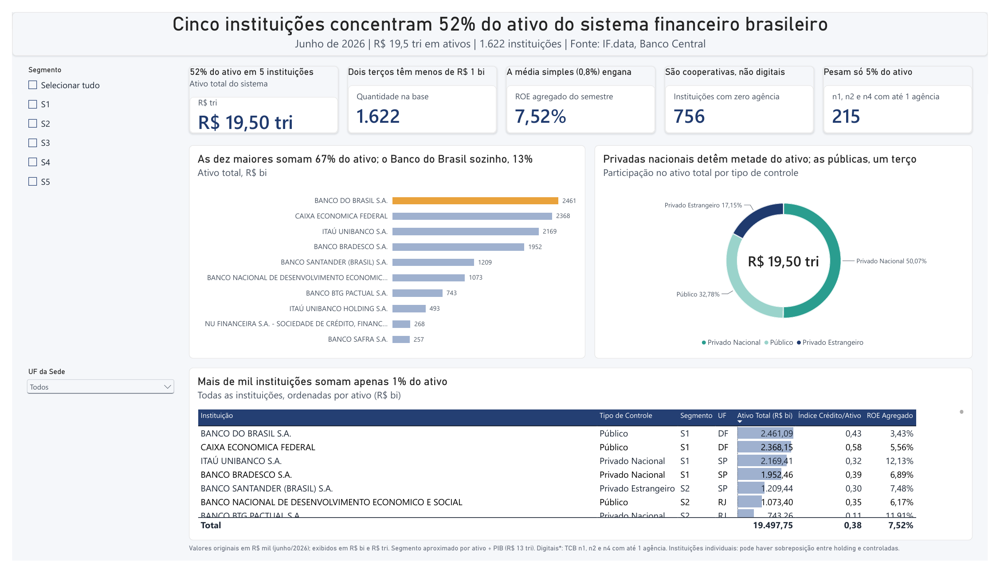
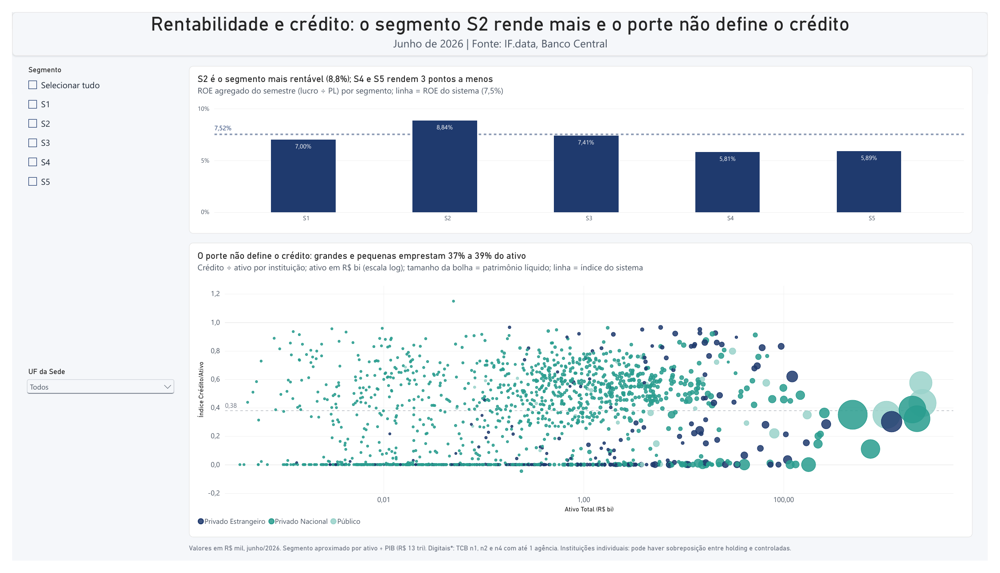

# Dashboard Power BI — Sistema Financeiro Brasileiro

## Resumo

Dashboard interativo construído no Power BI Desktop com dados reais do IF.data.
O painel tem duas páginas e responde 6 perguntas de negócio sobre concentração de ativos,
rentabilidade e estrutura do sistema financeiro brasileiro em junho/2026.



## Objetivos

- Conectar e transformar a base IF.data no Power Query (tratamento de `NI`, tipos e colunas derivadas)
- Criar medidas DAX com SUM, DIVIDE, CALCULATE, AVERAGEX, RANKX e TOPN
- Construir visuais interativos com filtros por segmento e por UF
- Publicar o relatório no Power BI Service

## Perguntas respondidas pelo painel

1. Qual o ativo total do sistema financeiro?
2. Quais são as 10 maiores instituições por ativo?
3. Como o ativo se distribui por tipo de controle?
4. Qual o ROE do semestre por segmento (S1 a S5, aproximado)?
5. Quantas instituições não têm agência física, e elas são digitais?
6. Qual a relação entre carteira de crédito e ativo total?

## Principais resultados

- Ativo total do sistema: **R$ 19,50 trilhões** (1.622 instituições, 1.571 com dados)
- Concentração: as **5 maiores** detêm **52%** do ativo; as **10 maiores**, **67%**; o Banco do Brasil sozinho, **13%**
- Por tipo de controle: privado nacional **50,07%**, público **32,78%**, privado estrangeiro **17,15%**
- ROE agregado do semestre: **7,52%** (a média simples, 0,8%, engana); o segmento S2 é o mais rentável (**8,84%**)
- As **756** instituições com zero agência são cooperativas, não digitais; as não bancárias e de pagamento com até 1 agência são **215**
- O porte não define o crédito: grandes e pequenas emprestam de **37% a 39%** do ativo

> O segmento S1 a S5 não existe na base. Ele foi aproximado no Power Query pela razão
> ativo ÷ PIB (PIB de R$ 13 tri, premissa). Por isso o Santander aparece como S2.

## Arquivos

| Arquivo | Descrição |
|---|---|
| `M5_Dashboard_IFdata.pbix` | Arquivo do Power BI Desktop |
| `M5_Dashboard_IFdata.pdf` | Exportação do dashboard em PDF (2 páginas) |
| `dashboard_screenshot.png` | Página 1: concentração e tipo de controle |
| `dashboard_screenshot_rentabilidade.png` | Página 2: rentabilidade por segmento e crédito × ativo |
| `M5_PowerBI_Guia.docx` | Guia passo a passo de construção |
| `M5_Power_Query_IFdata.m` | Script do Power Query (consulta `ifdata`) |
| `M5_Medidas_DAX_IFdata.dax` | Todas as medidas DAX do painel |
| `M5_Tema_IFdata.json` | Tema de cores do relatório |

📄 **Dashboard completo em PDF:** [M5_Dashboard_IFdata.pdf](M5_Dashboard_IFdata.pdf) (2 páginas)



## Medidas DAX criadas

```dax
Ativo Total = SUM ( ifdata[ativo_total] )
ROE Agregado = DIVIDE ( [Lucro Líquido], [Patrimônio Líquido] )
ROE Médio Simples =
AVERAGEX ( FILTER ( ifdata, ifdata[patrimonio_liquido] > 0 ),
           DIVIDE ( ifdata[lucro_liquido], ifdata[patrimonio_liquido] ) )
Qtd sem Agência = CALCULATE ( [Qtd Instituições], ifdata[num_agencias] = 0 )
Concentração Top 5 =
DIVIDE ( SUMX ( TOPN ( 5, ALLSELECTED ( ifdata ), ifdata[ativo_total], DESC ), ifdata[ativo_total] ),
         CALCULATE ( [Ativo Total], ALLSELECTED ( ifdata ) ) )
```

A lista completa está em [`M5_Medidas_DAX_IFdata.dax`](M5_Medidas_DAX_IFdata.dax).

## Como abrir

1. Instale o [Power BI Desktop](https://powerbi.microsoft.com/desktop) (gratuito, Windows)
2. Abra `M5_Dashboard_IFdata.pbix`
3. Para atualizar os dados, aponte a consulta `ifdata` para a planilha [`../excel/M3_IFdata_Exercicios.xlsx`](../excel/M3_IFdata_Exercicios.xlsx) (aba `Base_IFData_Original`), como descrito em `M5_Power_Query_IFdata.m`

## Tecnologias


- Power BI Desktop
- DAX (Data Analysis Expressions)
- Power Query (linguagem M)

## Fonte dos dados

IF.data — Portal de Dados do Banco Central do Brasil  
Junho/2026 — Valores em R$ mil  
https://www3.bcb.gov.br/ifdata
