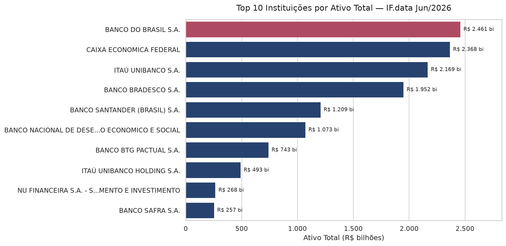
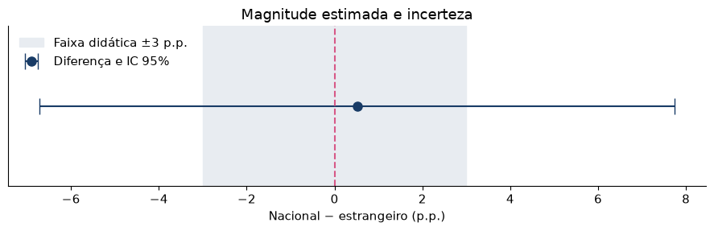

# Análise Python — Sistema Financeiro Brasileiro com Pandas e Seaborn

## Resumo

Análise exploratória completa do sistema financeiro brasileiro usando dados reais
do IF.data (Banco Central, junho/2026). O projeto cobre limpeza de dados, análise
estatística, visualização e automação de relatórios por segmento — tudo documentado
em Jupyter Notebook. Inclui também um estudo de **estatística inferencial**
(intervalo de confiança, teste t de Welch, tamanho de efeito e bootstrap).

## Objetivos

- Ler e limpar a base IF.data com Pandas (valores `NI`, linhas de totais, números como texto)
- Realizar análise exploratória (EDA) completa
- Criar visualizações profissionais com Matplotlib e Seaborn
- Exportar resultados para Excel com múltiplas abas
- Automatizar relatórios por segmento (TCB) e por tipo de controle com funções Python
- Aplicar inferência estatística a uma comparação entre grupos

## Principais resultados

- Mediana do ativo total: **R$ 293.113 mil** (vs média de **R$ 12.411.045 mil** — a média é 42,3 vezes a mediana: alta concentração)
- Correlação ativo/agências: **0,91** — os maiores ativos estão nas instituições com grande rede física, mas correlação não indica causa
- Segmento com maior ROE do semestre: **n2** (não bancário de mercado de capitais), com ROE agregado de **9,8%**; pela média simples, lidera **b3C** (centrais de cooperativas), com **4,0%**
- Pelo ROE agregado, o controle privado nacional é o mais rentável (**8,5%**); pela média simples, o público lidera (**8,0%**) — muitas instituições pequenas com prejuízo puxam a média simples para baixo
- Sem agência física: **756** instituições na base, todas cooperativas, não bancos digitais. Dessas, **737** têm dados contábeis (**46,9%** das instituições com dados) e somam **6,4%** do ativo; as outras 19 não informaram valores e ficam fora dos cálculos

## Arquivos

| Arquivo | Descrição |
|---|---|
| `M6_Python_IFdata.ipynb` | Notebook principal com análise completa e conclusão |
| `top10_ativo.png` | Top 10 instituições por ativo total |
| `roe_segmento.png` | ROE médio do semestre por segmento (TCB) |
| `ativo_controle.png` | Distribuição de ativo por tipo de controle |
| `correlacao_ifdata.png` | Heatmap de correlação entre variáveis |
| `dados/ifdata_junho_2026.csv` | Base IF.data usada pelo notebook |
| `saidas/` | Demais saídas do notebook: gráficos por segmento e por controle, dispersão crédito × ROE, `M6_Analise_IFdata.xlsx` (3 abas), relatórios e base limpa |
| `estatistica_inferencial/M2_Estatistica_Inferencial_IFdata.ipynb` | Estudo de inferência estatística (ver abaixo) |
| `estatistica_inferencial/*.png` | Histogramas, diferença com IC 95% e distribuição bootstrap |



## Como executar

**Opção 1 — VS Code (recomendado)**
```bash
# Instalar dependências
pip install pandas openpyxl matplotlib seaborn numpy scipy jupyter

# Abrir o notebook (rode a partir desta pasta, para o caminho dados/ funcionar)
code M6_Python_IFdata.ipynb
```

**Opção 2 — Google Colab (zero instalação)**
1. Acesse [colab.research.google.com](https://colab.research.google.com)
2. Faça upload do notebook `M6_Python_IFdata.ipynb`
3. Crie a pasta `dados/` e faça upload de `dados/ifdata_junho_2026.csv` nela
4. Execute célula por célula (Shift + Enter)

## Tecnologias


- Python 3.11+
- Pandas 2.x — manipulação de dados
- Matplotlib + Seaborn — visualização
- SciPy — testes estatísticos
- OpenPyXL — exportação para Excel
- Jupyter Notebook — ambiente de análise

## Estrutura do notebook

| Parte | Conteúdo |
|---|---|
| 1 | Imports e configuração |
| 2 | Carregamento dos dados |
| 3 | Limpeza e preparação |
| 4 | Análise exploratória (EDA) |
| 5 | Visualizações |
| 6 | Exportação de resultados |
| 7 | Automação por segmento e por tipo de controle |
| 8 | Boas práticas, checklist e conclusão |

## Estatística inferencial

**Pergunta:** a relação patrimônio líquido/ativo (PL/ativo) é diferente entre bancos b1
de controle privado nacional e de controle estrangeiro?

O notebook [`estatistica_inferencial/M2_Estatistica_Inferencial_IFdata.ipynb`](estatistica_inferencial/M2_Estatistica_Inferencial_IFdata.ipynb)
usa as 106 instituições b1 elegíveis (59 nacionais e 47 estrangeiras) e um desenho didático
de 80 sorteios com reposição por grupo. O recorte vem embutido no notebook, sem download.

- IC 95% da média do grupo nacional: **13,50% a 24,81%** (média de 19,16%)
- Teste t de Welch: diferença de **0,51 p.p.**, **p = 0,889**, IC 95% de **−6,71 a 7,73 p.p.** — não rejeitamos a igualdade, sem demonstrar equivalência
- Tamanho de efeito: d de Cohen **0,022**
- Bootstrap (5.000 repetições): IC de **−6,58 a 7,76 p.p.**, coerente com Welch; cobertura empírica do IC t de **93,2%**
- Planejamento de teste A/B (cenário fictício): **4.438 clientes por grupo** para detectar +2 p.p. sobre 12%



## Fonte dos dados

IF.data — Portal de Dados do Banco Central do Brasil  
Junho/2026 — Valores em R$ mil  
https://www3.bcb.gov.br/ifdata
